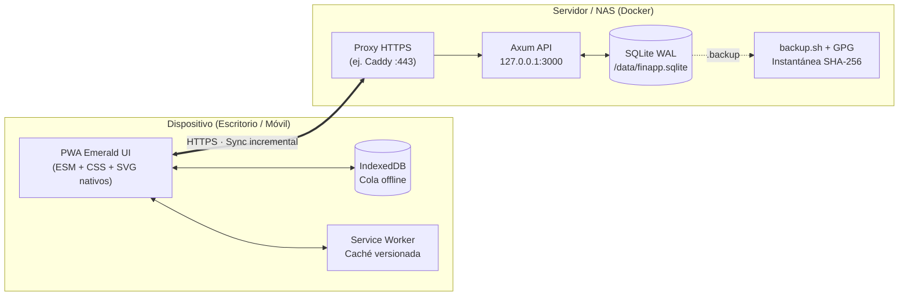

<div align="center">

# MisFinanzas

**Gestión patrimonial personal *offline-first* en guaraníes (`PYG`, enteros exactos).**  
Backend en **Rust · Axum · SQLite (WAL)** + Interfaz **PWA** sin dependencias externas.

[](https://github.com/mateoschreiber/FinApp/actions/workflows/ci.yml)
[](https://github.com/mateoschreiber/FinApp/releases/tag/latest)
[](Cargo.toml)
[](migrations/)
[](static/manifest.webmanifest)

</div>

---

## Release actual — `v1.0.0` (*Emerald Private Wealth*)

> [!TIP]
> **Descarga oficial:** el binario compilado para Linux (`x86_64`) junto con los activos estáticos y su firma `SHA-256` se publican automáticamente en el release [**`latest`**](https://github.com/mateoschreiber/FinApp/releases/tag/latest) en cada actualización verificada de `main`.

### Novedades clave de `v1.0.0`
- **Interfaz Emerald Private Wealth**: temas *Claro Alabastro*, *Obsidiana* y *Sistema*; efectos *spotlight*, paneles laterales animados (*Slide-Over Drawers*), notificaciones flotantes y paleta de comandos **`Ctrl+K`**.
- **Dashboard Bento con analítica nativa SVG**: tarjeta *Bóveda PYG* con sparkline de flujo acumulado diario, gráfico *donut* de gastos por categoría, tarjetas de crédito metálicas con filtro por clic e historial agrupado por fecha.
- **Registro ultrarrápido en guaraníes**: chips acumulables (`+50 mil`, `+100 mil`, `+500 mil`, `+1 millón`), atajo `Shift+Enter` (*Guardar y agregar otro*), duplicación de movimientos y alta inmediata de cuentas o categorías sin salir del formulario.
- **CRUD integral y administración**: gestión completa de cuentas, tarjetas, categorías, presupuestos, anulación de préstamos impagos, perfil propio (`PATCH /api/me`) y administración de usuarios y roles (`/api/users`).
- **Seguridad de sesión activa**: hashing `Argon2id`, CSP estricta sin scripts externos y **cierre automático tras 5 minutos de inactividad** sincronizado entre servidor y pestañas con contador en vivo.

---

## Arquitectura



### Módulos incluidos

| Sección | Capacidades principales |
| :--- | :--- |
| **Resumen** | Bóveda PYG con sparkline mensual, donut de gastos, tarjetas de cuentas/crédito interactivas, historial agrupado por fecha y resolución de conflictos offline. |
| **Nuevo movimiento** | Gastos, ingresos, pagos de tarjeta, transferencias y reintegros con atajos de importe en `Gs.`, duplicación y creación inline de catálogos. |
| **Créditos** | Compras en cuotas, cierres/vencimientos de tarjeta, imputación de pagos, préstamos con amortización francesa o alemana (`V2` entera exacta) y anulación de préstamos impagos. |
| **Planificación** | Informe mensual, presupuestos editables por categoría, gastos recurrentes, metas de ahorro, adjuntos (`PNG`/`JPG`/`PDF`) y cierre mensual. |
| **Importar y exportar** | Importación XLSX (`Cuentas`, `Categorias`, `Movimientos`) con vista previa, mapeo y control de saldos; exportación y conciliación bancaria CSV. |
| **Configuración** | Centro de control en pestañas: *Cuentas y Tarjetas*, *Categorías*, *Usuarios* (administradores) y *Mi Perfil y Apariencia*. |

---

## Despliegue rápido

### Docker Compose (Recomendado)

1. Crea `.env` en la raíz con el origen exacto desde el cual accederás a la aplicación:
   ```dotenv
   FINAPP_ORIGIN=https://finanzas.tudominio.com
   ```
   *(Para pruebas locales puedes usar `http://127.0.0.1:3000`.)*

2. Construye e inicia el servicio (en una base vacía crea el administrador inicial):
   ```bash
   export FINAPP_ADMIN_USERNAME=admin
   read -rsp 'Contraseña (>= 12 caracteres): ' FINAPP_ADMIN_PASSWORD; echo
   export FINAPP_ADMIN_PASSWORD
   export FINAPP_VERSION=$(git rev-parse --short HEAD)
   docker compose up -d --build
   ```

3. Limpia las credenciales temporales del entorno del contenedor:
   ```bash
   unset FINAPP_ADMIN_USERNAME FINAPP_ADMIN_PASSWORD
   docker compose up -d --force-recreate
   ```

> [!IMPORTANT]
> Los datos persisten en el volumen Docker `finapp_data`. **No ejecutes `docker compose down -v`** si deseas conservar tu base de datos.

### Ejecución local (Cargo)

```bash
export FINAPP_ORIGIN=http://127.0.0.1:3000
export FINAPP_ADMIN_USERNAME=admin
export FINAPP_ADMIN_PASSWORD=adminhomeadmin
cargo run --release --locked
```

---

## Variables de entorno

| Variable | Por defecto | Descripción |
| :--- | :--- | :--- |
| `FINAPP_ORIGIN` | *(obligatoria)* | Origen permitido (`https://host` o loopback `http://localhost`, `http://127.0.0.1`, `http://[::1]` sin barra final). |
| `FINAPP_BIND` | `127.0.0.1:3000` | Dirección de escucha (`0.0.0.0:3000` en Docker, publicado únicamente en `127.0.0.1:3000`). |
| `FINAPP_DB_PATH` | `finapp.sqlite` | Ruta del archivo SQLite (`/data/finapp.sqlite` en contenedor). |
| `FINAPP_ADMIN_USERNAME` | — | Administrador inicial (solo se aplica si no existen usuarios en la base). |
| `FINAPP_ADMIN_PASSWORD` | — | Contraseña inicial (`12` a `256` caracteres; nunca sobrescribe cuentas existentes). |
| `FINAPP_VERSION` | `unversioned` | Identificador estampado en `static/sw.js` para renovar la caché de la PWA. |

---

## Operación

### Actualizar servicio
```bash
git pull --ff-only
export FINAPP_VERSION=$(git rev-parse --short HEAD)
docker compose up -d --build --no-deps app
curl --fail --silent http://127.0.0.1:3000/health
```

### Respaldo y verificación
```bash
# Instantánea consistente (.sqlite + .sqlite.sha256)
bash scripts/backup.sh "$HOME/finapp-backups"

# Verificación de integridad en contenedor aislado sin red
bash scripts/restore-check.sh "$HOME/finapp-backups/ARCHIVO.sqlite"

# Cifrado AES-256 para copia externa
gpg --symmetric --cipher-algo AES256 "$HOME/finapp-backups/ARCHIVO.sqlite"
```

---

## Estructura del proyecto

```text
FinApp/
├── src/                  # Servidor Rust + Axum (auth, finance, catalog, credit, planning, exchange, reconciliation)
├── migrations/           # Migraciones SQLite inmutables (001–009)
├── static/               # Interfaz PWA (HTML, CSS Emerald, ESM, fuentes locales, Service Worker)
├── scripts/              # Operación de respaldos y ensayo de restauración
├── Dockerfile            # Imagen multi-stage mínima sin privilegios
└── compose.yaml          # Orquestación lista para servidor local / NAS
```
