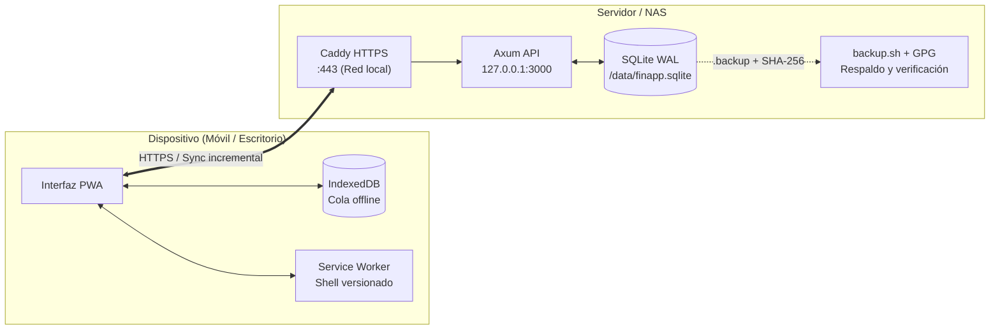

# MisFinanzas

[](https://github.com/mateoschreiber/FinApp/actions/workflows/ci.yml)
[](https://github.com/mateoschreiber/FinApp/releases/tag/latest)


Finanzas personales **offline-first** en guaraníes (`PYG`, enteros exactos). Servidor **Rust + Axum + SQLite (WAL)** e interfaz **PWA** sin dependencias de frontend.



---

## Módulos

| Vista | Qué hace |
| :--- | :--- |
| **Resumen** | Patrimonio, saldo neto de cuentas/tarjetas, flujo del mes y bandeja de **cambios locales** (pendientes o en conflicto). |
| **Nuevo movimiento** | Ingresos, gastos, transferencias, pagos de tarjeta y reintegros vinculados al gasto original. |
| **Créditos** | Compras en cuotas, cierres/vencimientos de tarjeta e imputación de pagos; préstamos con amortización francesa o alemana (`V2` entera exacta). |
| **Planificación** | Informe mensual, presupuestos por categoría, gastos recurrentes, metas de ahorro, comprobantes (`PNG`/`JPG`/`PDF`) y cierre de revisión mensual. |
| **Importar y exportar** | Importación XLSX (`Cuentas`, `Categorias`, `Movimientos`) con vista previa, mapeo de referencias y control de diferencias de saldo; conciliación bancaria CSV. |
| **Configuración** | Alta/archivo de cuentas y categorías, fechas de corte y **administración de usuarios** (visible para administradores). |

---

## Inicio rápido

### Opción A — Local (Cargo)

```bash
export FINAPP_ORIGIN=http://127.0.0.1:3000
export FINAPP_ADMIN_USERNAME=admin
export FINAPP_ADMIN_PASSWORD=adminhomeadmin
cargo run --release
```

Abre **http://127.0.0.1:3000** e inicia sesión con `admin` / `adminhomeadmin`.

### Opción B — Servidor / NAS (Docker Compose)

1. Crea `.env` con el origen exacto desde el que abrirás la app:
   ```dotenv
   FINAPP_ORIGIN=https://finanzas.tudominio.com
   ```
2. Arranca por primera vez (inicializa el administrador en una base vacía):
   ```bash
   export FINAPP_ADMIN_USERNAME=admin
   read -rsp 'Contraseña (>= 12 caracteres): ' FINAPP_ADMIN_PASSWORD; echo
   export FINAPP_ADMIN_PASSWORD
   export FINAPP_VERSION=$(git rev-parse --short HEAD)
   docker compose up -d --build
   ```
3. Retira las credenciales iniciales del entorno del contenedor:
   ```bash
   unset FINAPP_ADMIN_USERNAME FINAPP_ADMIN_PASSWORD
   docker compose up -d --force-recreate
   ```

> [!IMPORTANT]
> La base vive en el volumen `finapp_data`. **Nunca ejecutes `docker compose down -v`** si quieres conservar tus datos.

---

## Variables de entorno

| Variable | Por defecto | Descripción |
| :--- | :--- | :--- |
| `FINAPP_ORIGIN` | *(obligatoria)* | Origen permitido (`https://host` o `http://localhost`, `http://127.0.0.1`, `http://[::1]` sin barra final). |
| `FINAPP_BIND` | `127.0.0.1:3000` | Dirección de escucha (`0.0.0.0:3000` dentro de Docker, publicado solo en `127.0.0.1:3000` del host). |
| `FINAPP_DB_PATH` | `finapp.sqlite` | Ruta del archivo SQLite (`/data/finapp.sqlite` en Docker). |
| `FINAPP_ADMIN_USERNAME` | — | Usuario administrador inicial (solo actúa si la tabla `users` está vacía). |
| `FINAPP_ADMIN_PASSWORD` | — | Contraseña inicial (`12` a `256` caracteres; nunca sobrescribe usuarios existentes). |
| `FINAPP_VERSION` | `unversioned` | Commit estampado en `sw.js` durante el build para activar la actualización de la PWA. |

---

## Operación y mantenimiento

### Actualizar a la última versión

```bash
git pull --ff-only
export FINAPP_VERSION=$(git rev-parse --short HEAD)
docker compose up -d --build --no-deps app
curl --fail --silent http://127.0.0.1:3000/health
```

### Respaldo, cifrado externo y ensayo de restauración

```bash
# 1. Crear instantánea consistente (.sqlite + .sqlite.sha256)
bash scripts/backup.sh "$HOME/finapp-backups"

# 2. Ensayar restauración en un contenedor aislado sin red
bash scripts/restore-check.sh "$HOME/finapp-backups/ARCHIVO.sqlite"

# 3. Cifrar copia para almacenamiento externo
gpg --symmetric --cipher-algo AES256 "$HOME/finapp-backups/ARCHIVO.sqlite"
```

<details>
<summary><strong>Proxy HTTPS local con Caddy + Cloudflare DNS</strong></summary>

```caddyfile
finanzas.tudominio.com {
    tls {
        dns cloudflare {env.CF_API_TOKEN}
        resolvers 1.1.1.1
    }
    reverse_proxy 127.0.0.1:3000
}
```

Apunta `finanzas.tudominio.com` en tu DNS local hacia la IP privada del NAS. Los certificados se emiten por desafío DNS sin abrir puertos al exterior.
</details>

<details>
<summary><strong>Respaldo diario automático con systemd</strong></summary>

`/etc/systemd/system/finapp-backup.service`:
```ini
[Unit]
Description=Respaldo SQLite de MisFinanzas
After=docker.service
Requires=docker.service

[Service]
Type=oneshot
User=USUARIO_DOCKER
WorkingDirectory=/srv/FinApp
ExecStart=/usr/bin/bash /srv/FinApp/scripts/backup.sh /srv/finapp-backups
```

`/etc/systemd/system/finapp-backup.timer`:
```ini
[Unit]
Description=Respaldo diario de MisFinanzas

[Timer]
OnCalendar=daily
Persistent=true

[Install]
WantedBy=timers.target
```

Activar con:
```bash
sudo systemctl daemon-reload && sudo systemctl enable --now finapp-backup.timer
```
</details>

---

## Verificación y desarrollo

```bash
cargo fmt --check
cargo clippy --all-targets --locked -- -D warnings
cargo test --locked
npm test
```

- **Releases automáticos**: cada push a `main` que supera CI actualiza el release [`latest`](https://github.com/mateoschreiber/FinApp/releases/tag/latest) con el binario compilado y su checksum SHA-256.
- **Documentación interna**: [FASES.md](FASES.md) · [AUDITORIA.md](AUDITORIA.md) · [Especificación Fase 1](docs/superpowers/specs/2026-11-14-misfinanzas-fase-1-design.md)
